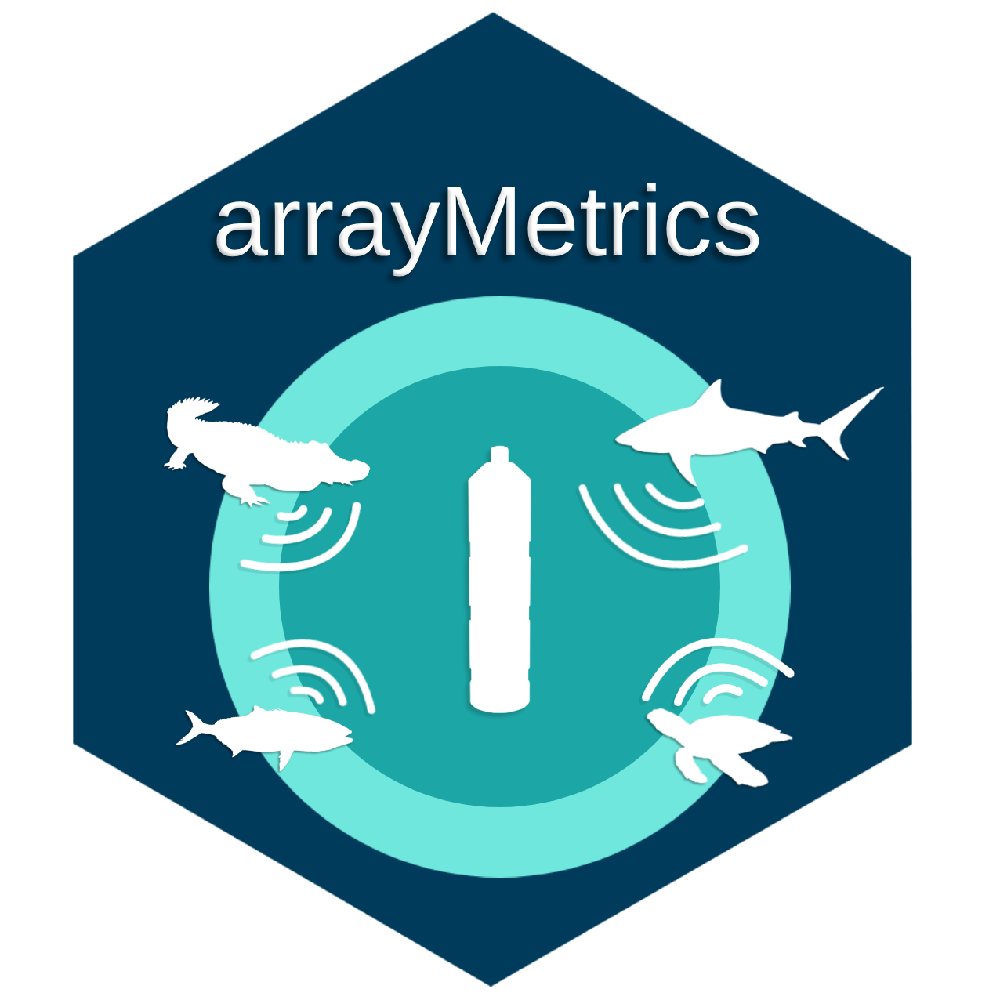
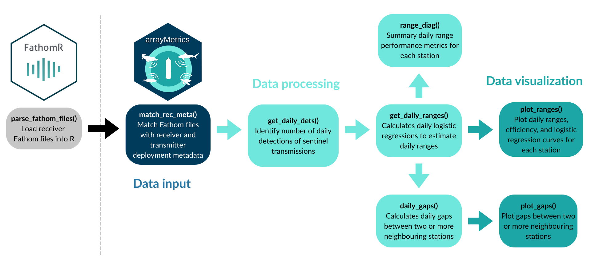
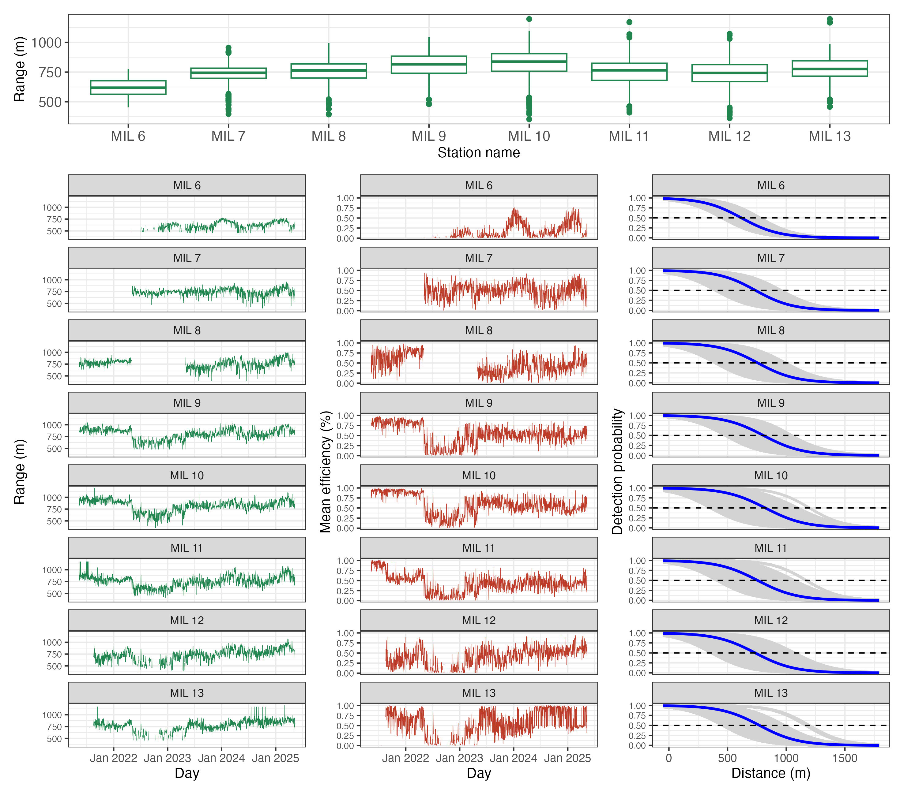
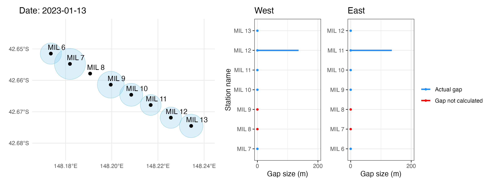

# arrayMetrics

[](https://github.com/IMOS-AnimalTracking/arrayMetrics)
[](https://github.com/IMOS-AnimalTracking/arrayMetrics/issues)
[](https://github.com/IMOS-AnimalTracking/arrayMetrics)
[](https://github.com/IMOS-AnimalTracking/arrayMetrics)
[](https://github.com/IMOS-AnimalTracking/arrayMetrics)

Calculate performance metrics of acoustic receiver arrays from detections of sentinel transmitters

<p align="center">
  <a href="#overview">Overview</a> •
  <a href="#installation">Installation</a> •
  <a href="#key-functionalities">Key functionalities</a> •
  <a href="#what-to-do-if-you-encounter-a-problem">Issues</a> •
  <a href="#how-to-contribute">Contributions</a> •
  <a href="#acknowledgements">Acknowledgements</a> •
  <a href="#licence">Licence</a>
</p>

<br>

## Overview

arrayMetrics is an R package aimed at calculating **daily detection ranges** of acoustic receivers. Daily range calculations are performed based on **detections from sentinel transmitters** deployed at fixed locations away from the acoustic receivers. Sentinel transmitters can be either: 
 
 1. Neighbour acoustic receivers with internal transmitters turned on
 2. Range test transmitters

If your study area encompassess **multiple stations** with expected overlapping ranges, potential gaps in detection ranges of neighbouring stations can also be calculted.  

The main arrayMetrics workflow is outlined below: 

<p align="center">
  
</p>


## Installation

You will need the **remotes** package **to install arrayMetrics**:
```r 
install.packages("remotes")
library("remotes")     
```

Now you can install arrayMetrics using:
```r
install_github("IMOS-AnimalTracking/arrayMetrics", build_opts = c("--no-resave-data", "--no-manual"), build_vignettes = TRUE)
```

All the information you need on how to perform the arrayMetrics analysis can be found in the package vignettes:
```r
browseVignettes("arrayMetrics")
```


## Key functionalities

Match Fathom file detections with receiver deployment metadata:

```r
maria_sort <- match_rec_meta(input = maria_dets,
  rec_meta = "Input/IMOS_receiver_deployment_metadata.csv",
  rec_name = "receiver_name",
  station_name = "station_name",
  rec_deploy_id = "receiver_deployment_id",
  rec_deploy_datetime = "receiver_deployment_datetime", 
  rec_recover_datetime = "receiver_recovery_datetime",
  rec_lat = "receiver_deployment_latitude",
  rec_lon = "receiver_deployment_longitude",
  tz = "UTC")
```

Identify daily detections of sentinel transmitters and calculate daily ranges:

```r
maria_daily <- get_daily_dets(input = maria_sort)
maria_ranges <- get_daily_ranges(input = maria_daily)
```

Extract station performance diagnostics:

```r
# Get station diagnostics
df_diag <- range_diag(input = maria_ranges, 
  station_order = c("MIL 6", "MIL 7", "MIL 8", "MIL 9", "MIL 10", "MIL 11", "MIL 12", "MIL 13"))

as.data.frame(df_diag)
```

Example output of some of the metrics included in the ```range_diag``` output:

| station_name| days_range_prop| max_efficiency| min_range| mean_range| max_range|
|:------------|---------------:|--------------:|---------:|----------:|---------:|
|        MIL 6|            0.62|           0.76|    452.98|     617.91|    776.84|
|        MIL 7|            0.75|           0.94|    396.55|     737.90|    956.14|
|        MIL 8|            0.75|           0.98|    393.38|     756.56|    993.87|
|        MIL 9|            0.98|           0.98|    480.54|     804.65|   1045.45|
|       MIL 10|            1.00|           0.99|    352.84|     818.78|   1196.90|
|       MIL 11|            0.98|           1.00|    408.92|     755.77|   1170.56|
|       MIL 12|            0.86|           0.94|    362.08|     735.39|   1072.56|
|       MIL 13|            0.85|           1.00|    457.38|     772.41|   1197.22|

Plot station daily ranges:

```r
# Plot daily ranges
plot_ranges(input = maria_ranges,
  station_order = c("MIL 6", "MIL 7", "MIL 8", "MIL 9", "MIL 10", "MIL 11", "MIL 12", "MIL 13"))
```
<p align="center">
  
</p>


Calculate gaps between neighbouring stations:

```r
# Calculate daily gaps
maria_gaps1 <- daily_gaps(input = maria_ranges, 
  station_name = "station_name",
  station_order = c("MIL 6", "MIL 7", "MIL 8", "MIL 9", "MIL 10", "MIL 11", "MIL 12", "MIL 13"))
```

Plot gaps between neighbour stations:

```r
plot_gaps(ranges = maria_ranges,
  gaps = maria_gaps1, 
  station_name = "station_name",
  date = "2023-01-13",
  station_order = station_order = c("MIL 6", "MIL 7", "MIL 8", "MIL 9", "MIL 10", "MIL 11", "MIL 12", "MIL 13")) 
```
<p align="center">
  
</p>


## What to do if you encounter a problem

If you encounter a bug or unexpected/inconsistent behaviour when using this package, you can post an issue [here](https://github.com/IMOS-AnimalTracking/arrayMetrics/issues). First, have a read through the posted issues to see if others have encountered the same problem and whether a solution has been offered. You can reply to an existing issue if you have the same problem and have more details to share or you can submit a new issue. 

You will need to *clearly* describe the issue, include a reproducible example, describe what you expected to happen (but didn’t), and provide screenshots/images that illustrate the problem. To submit an issue, please fill out the "Bug report" template provided in the issues tab. 


## How to Contribute

Contributions from anyone in the Movement Ecology/Acoustic Telemetry communities are welcome. Consider submitting a feature request
[here](https://github.com/IMOS-AnimalTracking/arrayMetrics/issues/new/choose) to start a discussion. Alternatively, if your idea is well-developed then you can submit a pull request for evaluation
[here](https://github.com/IMOS-AnimalTracking/arrayMetrics/pulls).


## Acknowledgements

This work is part of the Australia’s Integrated Marine Observing System (IMOS, www.imos.org.au). IMOS is enabled by the National Collaborative Research Infrastructure Strategy (NCRIS). It is operated by a consortium of institutions as an unincorporated joint venture, with the University of Tasmania as Lead Agent. 


## Licence

 GNU General Public License (GPL>=3) https://www.gnu.org/licenses/gpl-3.0.en.html

<br>
<br>

**Contributors:**  

**Yuri Niella** @YuriNiella (IMOS Animal Tracking Facility, Sydney Institute of Marine Science)  
**Hugh Pederson** @hughpederson (Innovasea) 
